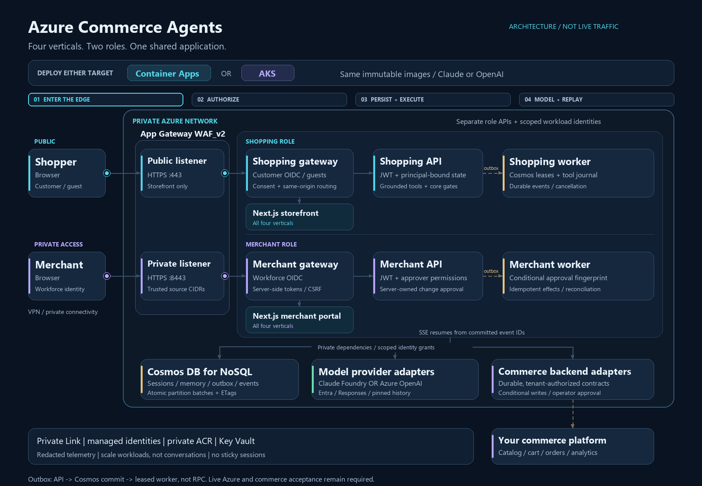
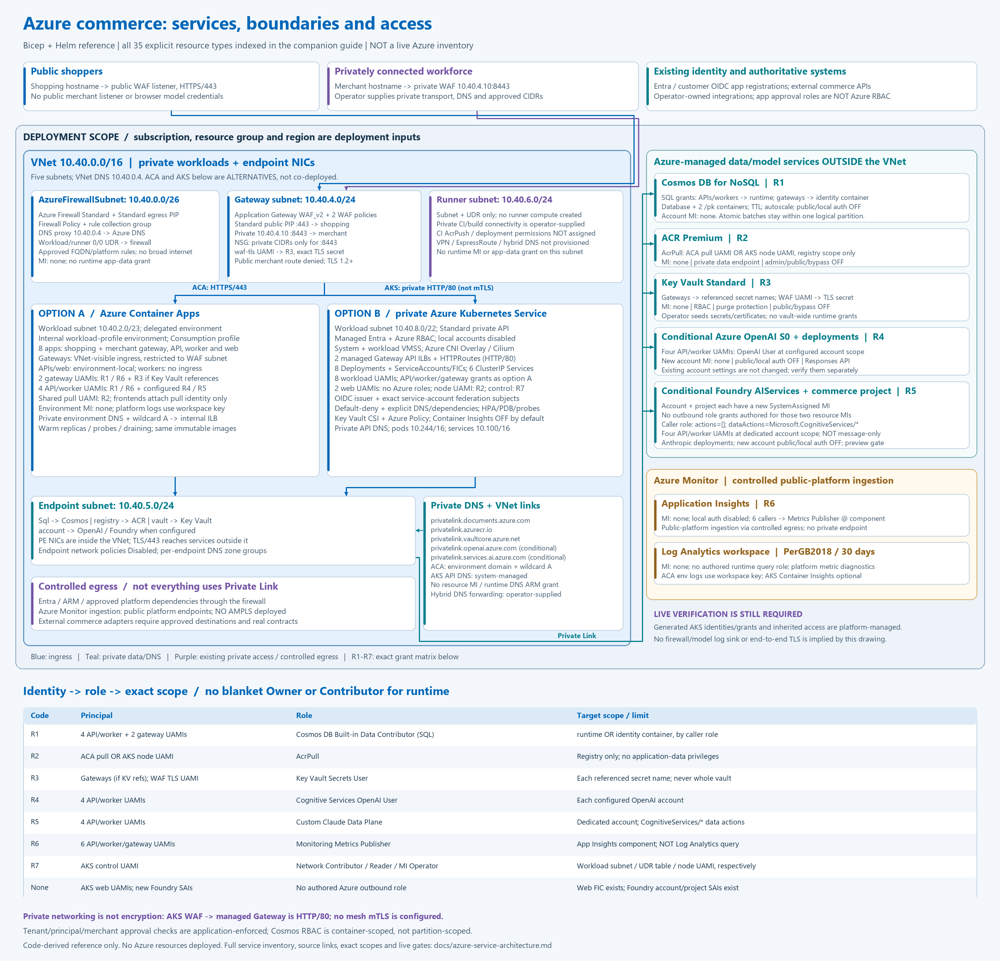

# Azure Commerce Agents

<picture>
  <source media="(prefers-reduced-motion: reduce)" srcset="docs/assets/azure-commerce-architecture.png">
  
</picture>

[View the static diagram](docs/assets/azure-commerce-architecture.png) |
[Detailed Azure services, private networking and RBAC](docs/azure-service-architecture.md) |
[Architecture and release gates](docs/azure-application.md)

<details>
<summary>Static Azure service, network boundary and managed identity diagram</summary>

[](docs/assets/azure-service-architecture.png)

[Full-size editable SVG](docs/assets/azure-service-architecture.svg) |
[Complete service inventory and identity-to-role matrix](docs/azure-service-architecture.md)

Code-derived reference, not a live Azure inventory. Container Apps and AKS are
alternative installations. Azure Monitor public ingestion and the AKS HTTP
backend hop are explicitly distinguished from private endpoint access.

</details>

This repository adapts [Anthropic's Commerce Agents](https://github.com/anthropics/commerce-agents)
at `fd4d59224ab96b43c6dc6888207c67b3bd5a24cf`, retaining its history, Apache-2.0
license, attribution, core safety gates, and local demos. The Azure application adds
Cosmos persistence, durable workers, an OIDC/guest gateway, Azure OpenAI Responses
and Foundry Claude providers, and independent Container Apps and AKS targets.

Start with the [Azure application guide](docs/azure-application.md),
[host contracts](apps/host/README.md), [gateway setup](docs/gateway-auth.md), and
[private infrastructure guide](docs/azure-infrastructure.md). Cloud deployment and
real commerce integrations are release gates, not completed live integrations.

Two commerce agents built on Claude: a **shopping agent** a business embeds in its app for
customers, and a **merchant agent** its staff use to run the back office. Each is defined
once (prompt, skills, tool contracts, gates) and runs on the Messages API, the Claude Agent
SDK, and Managed Agents; four runnable verticals show both over the same libraries.

> [!NOTE]
> Every company, brand, product, and person here is fictional; the only company is Zava.
> Nothing places an order, charges a card, or changes a live listing: `checkout` renders
> the cart for the host to complete, and every merchant write is staged until a person
> approves it. Business rules, authorization, and compliance are the deployment's.

## Deploy to Azure Container Apps

Use the Container Apps target independently; these steps do not install AKS.
Choose either the [isolated retail sample-data demo](docs/azure-retail-demo.md)
or the production application below. The retail demo has six apps, uses fixture
commerce data and does not provide real orders, payments or fulfillment.
Production requires an authoritative [backend adapter](docs/azure-application.md#backend-and-authorization-boundaries).

1. **Prepare the tools and target.** Install Python 3.11+, Node 22, Azure CLI,
   Bicep and GitHub CLI. Clone this repository, create a Python virtual
   environment and install `requirements-azure.txt`. Sign in to Azure and
   confirm the subscription, resource group and region:

   ```powershell
   az login
   $SubscriptionId = "<approved-subscription-guid>"
   $ResourceGroup = "<deployment-resource-group>"
   $Location = "<validated-public-azure-region>"
   az account show --subscription $SubscriptionId --output table
   ```

2. **Configure and validate the foundation.** Follow the
   [private infrastructure guide](docs/azure-infrastructure.md#container-apps-foundation-only-stage).
   Copy `infra/container-apps/foundation.parameters.example.json` to an ignored
   `.azure/foundation.parameters.json`; replace all placeholders and verify
   address ranges, private connectivity, service availability, model entitlement
   and quota before setting `modelAvailabilityVerified=true`. Keep
   `enableWorkloads=false` and `enableIngress=false`. Never commit credentials
   or actual deployment parameters. Create the approved resource group in
   `$Location` if it does not exist before running resource-group validation.

   ```powershell
   python infra\scripts\preflight.py --target container-apps --phase foundation --parameters .azure\foundation.parameters.json
   az bicep build --file infra\container-apps\main.bicep --outfile .azure\container-apps.json
   az deployment group validate --subscription $SubscriptionId --resource-group $ResourceGroup --template-file .azure\container-apps.json --parameters "@.azure\foundation.parameters.json" --validation-level Provider
   az deployment group what-if --subscription $SubscriptionId --resource-group $ResourceGroup --template-file .azure\container-apps.json --parameters "@.azure\foundation.parameters.json" --validation-level Provider
   ```

   Review applicable Azure policies, costs and the exact preview before
   proceeding; offline checks alone do not validate a live deployment.

3. **Deploy the approved foundation.** After validation and approval, use an
   incremental deployment:

   ```powershell
   az deployment group create --subscription $SubscriptionId --resource-group $ResourceGroup --name commerce-foundation --mode Incremental --template-file .azure\container-apps.json --parameters "@.azure\foundation.parameters.json"
   ```

   This provisions private services and the hosting environment, not a working
   application. Verify private DNS, routing, endpoint approval and scoped
   managed-identity permissions before building or rolling out workloads.

4. **Build immutable images privately.** Follow the
   [protected build setup](docs/azure-private-runners.md#protected-private-image-builds).
   Commission the private builder and normal `commerce-build` review gate,
   merge the reviewed source, then dispatch `private-build.yml` on `main`.
   Select `retail-release` for the gateway, API and both retail frontends, or
   `all` for every vertical. Approve the exact run through the normal environment
   review. Record its source SHA and image digests, complete the release
   scanning/signing gates and independently verify disposable-compute cleanup.

5. **Configure identity, secrets and the model.** Register exact HTTPS callback
   URLs and merchant/approver roles using the
   [gateway authentication guide](docs/gateway-auth.md). From approved private
   connectivity, seed role-specific Key Vault secrets and the TLS certificate;
   never pass secret values in CLI arguments or browser configuration. Configure
   the real backend and [provider settings](docs/azure-application.md#model-configuration)
   for Foundry Claude or Azure OpenAI, including authorized deployment names and
   a matching `COMMERCE_PROVIDER_ID` on APIs and workers. Retain private
   endpoints, Entra authentication and least-privilege runtime grants.

6. **Validate and deploy the application.** Populate an ignored application
   parameter file using `infra/container-apps/main.parameters.example.json`.
   Supply the accepted image digests, runtime settings and vault references;
   set `enableWorkloads=true` while keeping `enableIngress=false`. Run
   `preflight.py --target container-apps --phase application --parameters <file>`
   and repeat Provider validation, what-if and the approved incremental
   deployment with that file. Reject unexpected deletions or unrelated changes.
   Enable the edge only after private image pulls, dependencies, TLS and backend
   readiness pass. Keep merchant access private. The six-app retail demo uses
   its separate staged templates and operator-only authentication procedure,
   not production parameters with fixtures enabled.

7. **Verify and operate.** Check actual replica readiness, both role gateways,
   sign-in and unauthorized rejection, a streamed conversation and durable
   replay after reload. Test merchant isolation and approval authorization from
   the private network. Do not equate ARM success with a healthy application.
   To pause workloads, deactivate their active revisions with
   `az containerapp revision deactivate`; retain the revision names and use
   `az containerapp revision activate` to resume. Stopping apps does not stop
   charges for the firewall, database, registry or other provisioned services.

## Quick start: run the demos

Python 3.11+ and Node 22. Clone, install, add a key, run a vertical:

```bash
git clone https://github.com/avidunixuser/commerce-agents.git && cd commerce-agents
python3 -m venv .venv && source .venv/bin/activate
pip install -r requirements.txt       # the seven packages and their pinned dependencies
cp .env.example .env                  # add ANTHROPIC_API_KEY
(cd examples && npm ci)               # the eight web apps share one workspace
python scripts/run_demo.py retail     # API :8000 + storefront :3000
```

`--merchant` starts the portal instead of the storefront and `--all` starts both. The
verticals are `retail` (:3000, portal :3100), `travel` (:3001, :3101), `telecom` (:3002,
:3102), and `entertainment` (:3003, :3103); each README lists prompts to try on both surfaces.

## Quick start: build your own

The Claude Code plugin scaffolds an agent on these packages against your systems, or reviews
one you have. With the repo cloned as above (the plugin reads it as the reference):

```bash
claude plugin marketplace add anthropics/commerce-agents
claude plugin install commerce-builder@claude-commerce-agents
claude
/scaffold-commerce-agent a shopping assistant for our store
```

The command asks about your stack, plays the plan back, and builds the project; `/add-commerce-flow`
and `/author-commerce-evals` continue from there, and `/review-commerce-agent` starts from an agent
that already exists ([`plugins/commerce-builder/`](plugins/commerce-builder/)). Each command also
runs when a request matches its description, so naming it is optional.

## The two agents

The **shopping agent** searches, compares, plans, fills the cart, answers order and policy
questions, and remembers what a customer tells it. Its five flows are the skills in
[`shopping-agent/skills/`](shopping-agent/skills/); a deployment implements
[`StorefrontBackend`](shopping-agent/core/shopping_agent/backend.py) over its catalog,
cart, order, and policy systems.

The **merchant agent** explains performance, maintains listings, acts on inventory and order
alerts, prices and promotes, and drafts campaigns; every write is a staged change the host's
approval surface applies. Its five flows are the skills in [`merchant-agent/skills/`](merchant-agent/skills/);
a deployment implements [`MerchantBackend`](merchant-agent/core/merchant_agent/backend.py) over
its analytics, catalog, inventory, pricing, and campaign systems.

## Layout

| Directory | Contents | pip package, `import` name |
|---|---|---|
| [`commerce-common/`](commerce-common/) | What both roles share: config, fencing, memory, skills, grounding, presentation, executor frame, events | `commerce-common`, `commerce_common` |
| [`apps/host/`](apps/host/) | Authenticated role APIs, atomic Cosmos stores, outbox workers, replay, approvals and migration | `commerce-azure-host`, `commerce_host` |
| [`apps/gateway/`](apps/gateway/) | Server-owned OIDC sessions, guest assertions and same-origin application routing | `commerce_gateway` |
| [`infra/`](infra/) and [`deploy/helm/`](deploy/helm/) | Public-Azure private networking/services, independent Container Apps/AKS targets and hardened workloads | — |
| [`shopping-agent/core/`](shopping-agent/core/) | Shopping types, `StorefrontBackend`, prompt, tool contracts, gates, executor | `shopping-agent-core`, `shopping_agent` |
| [`shopping-agent/runtime-messages-api/`](shopping-agent/runtime-messages-api/) | `ShoppingAgent`, the turn loop on the Messages API | `shopping-agent-runtime`, `shopping_agent_runtime` |
| [`shopping-agent/runtime-agent-sdk/`](shopping-agent/runtime-agent-sdk/) | The shopping agent on the Agent SDK, with a console | `shopping-agent-sdk`, `shopping_agent_sdk` |
| [`shopping-agent/managed-agents/`](shopping-agent/managed-agents/) | Manifest and storefront MCP server for Managed Agents | — |
| [`merchant-agent/core/`](merchant-agent/core/) | Merchant types, `MerchantBackend`, prompt, tool contracts, change guardrails, gates, executor | `merchant-agent-core`, `merchant_agent` |
| [`merchant-agent/runtime-messages-api/`](merchant-agent/runtime-messages-api/) | `MerchantAgent` and the analysis delegate on the Messages API | `merchant-agent-runtime`, `merchant_agent_runtime` |
| [`merchant-agent/runtime-agent-sdk/`](merchant-agent/runtime-agent-sdk/) | The merchant agent on the Agent SDK, with an approving console | `merchant-agent-sdk`, `merchant_agent_sdk` |
| [`merchant-agent/managed-agents/`](merchant-agent/managed-agents/) | Manifest, merchant MCP server, scheduled digest for Managed Agents | — |
| [`examples/`](examples/) | Four verticals, shared host code (`demo_common/`), shared web code (`web-shared/`) | — |
| [`plugins/commerce-builder/`](plugins/commerce-builder/) | The Claude Code plugin | — |
| [`docs/`](docs/) | `safety.md` (enforced rules), `backends.md` (mapping your systems), `deployment.md` (other platforms) | — |
| [`tests/`](tests/) | Cross-package suites; each package also has its own `tests/` | — |
| [`scripts/`](scripts/) | `install.sh`, `run_demo.py`, `smoke_chat.py`, `screenshot_tour.py`, `check.py`, `deploy_managed_agent.sh`, `verify_all.py` | — |

## Three ways to run an agent

**Messages API.** The reference loop; the examples are host applications around it:

```python
from pathlib import Path

from shopping_agent import ShoppingAgentConfig
from shopping_agent_runtime import ShoppingAgent

agent = ShoppingAgent(backend=your_backend, skills_dir=Path("shopping-agent/skills"),
                      config=ShoppingAgentConfig(brand_name="Your Store"))
async for event in agent.stream_turn(messages, session, state):
    ...   # text_delta, tool_call, ui, cart_update (change_update on the merchant side), turn_complete
await agent.update_memory(messages, session)   # memory extraction; this path only
```

The example hosts take the session id in an `X-Session-Id` header.

**Agent SDK.** The same prompt, skills, and tools, with the SDK running the loop; the host
prefetches grounding reads, and nothing runs after the turn:

```bash
python shopping-agent/runtime-agent-sdk/main.py --once "a two-person tent under $250"
python merchant-agent/runtime-agent-sdk/main.py          # approves staged changes with y/N
```

**Managed Agents.** A hosted agent over the same skills and contracts, calling your MCP server:

```bash
scripts/deploy_managed_agent.sh shopping-agent/managed-agents/shopping-agent   # or merchant-agent/...; --live deploys
```

## Safety

Fencing, provenance gates, caps, memory validation, and the merchant approval gate run
inside the tool call and hold on all three paths; grounding, the analysis budgets, and memory
extraction are runtime features. [`docs/safety.md`](docs/safety.md) lists each rule with its
module and paths, and what a deployment adds first; the examples have no authentication and
the MCP servers bind to loopback.

## Verticals

| Example | Storefront | Portal |
|---|---|---|
| [`examples/retail/`](examples/retail/) Zava | Search, comparison, plans, cart, checkout, memory over the built-in components | Digest, staged restocks and listing fixes, analysis delegate over a SQL view |
| [`examples/travel/`](examples/travel/) Zava Travel | Date-bound inventory and a `present_itinerary` extension | Occupancy calendar and date-window rate moves |
| [`examples/telecom/`](examples/telecom/) Zava Mobile | Account context, plan matrix, server-authored fee disclosures | Plan mix, price moves that state the lines affected, protected regulated fees |
| [`examples/entertainment/`](examples/entertainment/) Zava Tickets | Timed holds, waitlists, transfers, venue map, all-in fee disclosures | Event pacing, hold releases that add real capacity, fee-preserving price moves |

Each example's README has a `Try` section: the turns `scripts/smoke_chat.py` runs, and single
prompts with what a good answer does.

## Verify

```bash
ruff check . && ruff format --check . && pytest && python scripts/check.py
python scripts/verify_all.py                        # the line above plus deploy dry runs and web builds
python scripts/smoke_chat.py --vertical travel      # one live conversation; needs a key
```

`requirements-dev.txt` adds pytest and ruff. CI installs from it on two Python versions,
builds the eight web apps, and checks that the package names stay unregistered on the
public index (the pin files install them from their directories, never from the index). To confirm caching, read
`cache_read_input_tokens` from `turn_complete`, or the line each model call logs on its
runtime's logger: zero on a second turn means the prefix changed.

## Deploying elsewhere

The runtimes take any `anthropic` client as `client=` and the SDK runtimes take the platform
from the CLI environment; [`docs/deployment.md`](docs/deployment.md) covers GCP Vertex AI, AWS Bedrock, Microsoft Foundry, and gateways.

## MCP connectors

None ship; both agents reach your systems through the backend interfaces. Where an official
connector is the source of record, it is the integration target: analytics warehouses (Snowflake,
BigQuery, Databricks, Amplitude), finance (Stripe, Square, PayPal, QuickBooks), delivery (Slack, Google Drive, Gmail).
A commerce platform's own MCP server for catalog, cart, or checkout is called from a backend
method server-side; on Managed Agents the manifest mounts it beside the role's server, and the
provenance gates stay in front of every write.

## Making it yours

- **Backend methods.** Each one calls your service server-side with the
  credential your host holds for the session; the model reads only the result. A flow whose
  steps have a fixed order enforces that order in the backend.
- **Read the backend guide.** [`docs/backends.md`](docs/backends.md) walks through
  identity and credentials, ordered flows, checkout, products with options, and figures
  your platform cannot supply.
- **The same interface covers other business shapes.** On a marketplace, seller is a search
  dimension and the merchant agent acts for the operator the session names. With account or
  contract pricing, the price quoted is the session account's. With no checkout of your
  own, turn the cart off or hand it to a quote, a purchase order, or a hosted checkout URL.
- **Checkout hands off.** The checkout card links to your own checkout route, or to the
  platform's hosted checkout URL (one per seller on a marketplace). The backend returns the
  URL and the host renders it; the model never sees it.
- **Start small.** A shopping pilot implements search and product details and stubs the
  rest; a stubbed method returns an unavailable result and changes no prompt bytes. A
  merchant pilot implements the eight read methods and has the writes refuse; digests and
  metrics then run with no write path.
- **Switch off what you do not have.** A system the business lacks entirely (no cart on a
  referral surface, no order tracking) is an `enable_*` switch turned off, which removes its
  tools, prompt lines, and grounding rule on every path; park the flows that need it under
  `skills/_staged/`. The merchant config has the same switches for listing edits, inventory,
  pricing, and campaigns.
- **Add your own.** A flow is a directory with a `SKILL.md` under either `skills/`. Domain
  UI is a `PresentationExtension` (the verticals ship seven). `brand_name`,
  `assistant_name`, and `brand_voice` on either config set the identity.

## License

Copyright 2026 Anthropic PBC. Licensed under the [Apache License 2.0](./LICENSE).
This is a reference implementation; it is not maintained and does not accept contributions.
