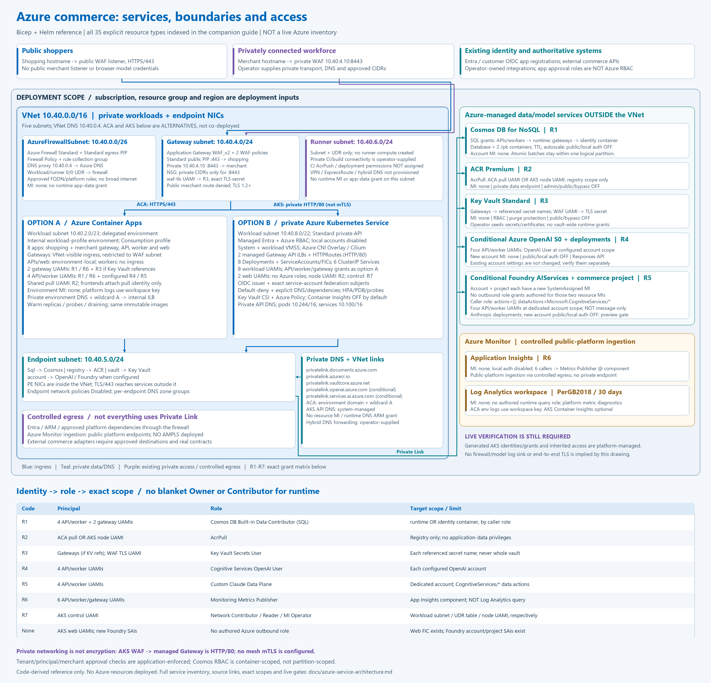
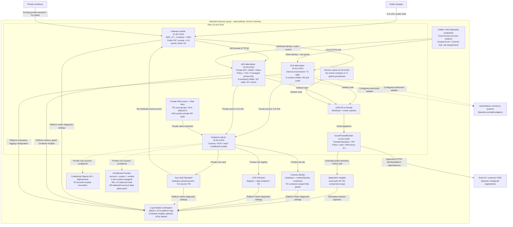

# Azure service, network and identity architecture

**Scope:** checked-in Bicep and Helm, not a live Azure inventory.

**Subscription / resource group / region:** supplied at deployment time.

**Inventory:** all 35 explicit Azure resource types referenced in the templates,
including existing-resource references; conditional resources do not imply a
fixed resource count or that both hosting targets are installed.

The two targets are independent installations of the same application. Choose
Container Apps **or** AKS; each installation has its own VNet, private services
and identities. Model families can be created or referenced, subject to the
documented availability and private-inference gates.

## Static architecture diagram

[Open full-resolution PNG](assets/azure-service-architecture.png) |
[Open editable vector SVG](assets/azure-service-architecture.svg) |
[Deployment and live acceptance gates](azure-infrastructure.md)

The PaaS accounts are **outside the VNet**. Their private endpoint NICs are
inside the endpoint subnet. Monitoring deliberately has a different boundary:
the templates do not provision Azure Monitor Private Link Scope (AMPLS).

## Resource inventory

| Service / resource family | Network and service configuration | Managed identity and authored access | Source |
|---|---|---|---|
| VNet, five subnets and gateway NSG | `10.40.0.0/16`; workload subnet differs by target; only the gateway subnet receives the authored NSG | No resource MI; AKS control UAMI has Network Contributor on the workload subnet only | [network](../infra/modules/network.bicep), [AKS](../infra/aks/main.bicep) |
| Azure Firewall Standard, Firewall Policy/rules, Standard public IP and UDR | DNS proxy `10.40.0.4`; workload/runner `0.0.0.0/0` routes to the firewall; approved HTTPS/platform dependencies only | No resource MI or runtime data grants; AKS control UAMI has Reader on the route table, not route-write access | [network](../infra/modules/network.bicep) |
| Application Gateway WAF_v2, two WAF policies, Standard public IP | Public shopping listener `:443`; private merchant listener `10.40.4.10:8443`; source CIDR restrictions; separate prevention policies | `${name}-waf-tls` UAMI: Key Vault Secrets User on the referenced TLS secret only | [WAF](../infra/modules/application-gateway.bicep) |
| Container Apps managed environment and eight apps, conditional | Internal workload-profile environment, Consumption profile; two VNet-visible gateways restricted to the WAF subnet, two environment-local APIs, two environment-local frontends and two ingress-free workers | Six separate runtime UAMIs; shared pull UAMI attached for registry access; frontends attach only the pull identity; environment has no authored MI | [ACA](../infra/container-apps/main.bicep), [app](../infra/modules/container-app.bicep) |
| Private AKS Standard, conditional alternative | Private API, managed Entra/Azure RBAC, local accounts disabled, Azure CNI Overlay/Cilium; system and workload VMSS pools; platform-managed node resource group | Control UAMI and separate kubelet/node UAMI; eight workload UAMIs federated to exact service-account subjects | [AKS](../infra/aks/main.bicep) |
| AKS managed Gateway API, Policy and Key Vault CSI add-ons | Two private managed Gateway load balancers, HTTPRoutes, default-deny policies, explicit DNS/dependency allowances; eight Deployments/SAs/HPAs/PDBs and six app ClusterIP Services | Workload Identity for gateway CSI secret access; generated add-on/controller identities and effective grants require live inspection | [gateway](../deploy/helm/commerce-agents/templates/gateway.yaml), [workloads](../deploy/helm/commerce-agents/templates/workloads.yaml), [policies](../deploy/helm/commerce-agents/templates/network-policy.yaml) |
| Cosmos DB for NoSQL, database and two containers | Private Link; public and local auth disabled; session consistency; continuous seven-day backup; autoscale database; `/pk` containers with TTL enabled | No account MI declared; SQL Data Contributor grants scoped to `runtime` for APIs/workers or `identity` for gateways | [services](../infra/modules/services.bicep), [identity](../infra/modules/identity.bicep) |
| ACR Premium | Private registry and dedicated data endpoint; public access, admin auth and trusted-service bypass disabled | No registry MI declared; AcrPull on the registry for ACA pull UAMI or AKS node UAMI only | [services](../infra/modules/services.bicep), [identity](../infra/modules/identity.bicep) |
| Key Vault Standard and existing secret references | Private Link; public access disabled; RBAC enabled; purge protection and 90-day soft deletion | No vault MI declared; gateway secret-level grants and WAF certificate-secret grant only; no API/worker vault grant | [services](../infra/modules/services.bicep), [identity](../infra/modules/identity.bicep), [WAF](../infra/modules/application-gateway.bicep) |
| Azure OpenAI account and model deployments, conditional | New S0 account or same-resource-group existing account; Private Link; new accounts disable public/local auth; Responses API | New account has no declared MI; four API/worker UAMIs have Cognitive Services OpenAI User at account scope | [models](../infra/modules/models.bicep), [access](../infra/modules/model-access.bicep) |
| Foundry AIServices account, commerce project and Anthropic deployments, conditional | New S0 account/project or existing account; Private Link; new accounts disable public/local auth; preview attestation and private-inference acceptance required | New account and project each have a system-assigned MI, with no authored outbound role assignments; four API/worker UAMIs get the custom Claude data-plane role at account scope | [models](../infra/modules/models.bicep) |
| Private endpoints, DNS zone groups, private DNS zones/VNet links and ACA wildcard record | Endpoint NICs in `10.40.5.0/24`; endpoint network policies disabled; private resolution for SQL/ACR/vault/models; ACA environment domain or AKS platform-managed API DNS | No MI or runtime ARM DNS/PE roles required for resolution; target service RBAC still controls data access | [endpoint](../infra/modules/private-endpoint.bicep), [ACA DNS](../infra/modules/aca-dns.bicep) |
| Application Insights and Log Analytics | Workspace-backed Insights, local auth disabled; 30-day PerGB2018 workspace; controlled public telemetry endpoints, **no AMPLS** | Six API/worker/gateway UAMIs have Monitoring Metrics Publisher on the Insights component; no authored application Log Analytics query role | [services](../infra/modules/services.bicep), [telemetry](../infra/modules/telemetry-access.bicep) |
| Azure Monitor diagnostic settings and optional Container Insights | Metrics for Cosmos, ACR, vault, WAF and AKS; ACA platform logs use the workspace configuration/key; AKS Container Insights defaults off pending redaction controls | Platform diagnostic ingestion is distinct from app Entra publishing; no blanket service-reader roles or runtime log-query grants | [services](../infra/modules/services.bicep), [WAF](../infra/modules/application-gateway.bicep), [AKS](../infra/aks/main.bicep) |
| Managed identities, federated credentials, role definitions/assignments | Resource-scoped grants; AKS issuer plus exact `system:serviceaccount:${namespace}:<workload>` subject and `api://AzureADTokenExchange` audience | See the complete matrix below; runtime identities are not Owner/Contributor | [identity](../infra/modules/identity.bicep), [models](../infra/modules/models.bicep), [AKS](../infra/aks/main.bicep) |

### External or operator-supplied dependencies

Microsoft Entra workforce identity, customer OIDC/External ID registrations,
issuer discovery/JWKS, public/private application DNS records, certificates,
private transport (VPN, ExpressRoute or equivalent), hybrid DNS forwarding,
private runner compute and authoritative commerce systems are operator inputs.
Their presence in the diagram is **not** a claim that the templates create them.
ARM, Microsoft Container Registry/package hosts and Azure Monitor are controlled
platform egress dependencies, not additional application deployments.

No Azure VPN Gateway, ExpressRoute circuit, DNS Private Resolver, runner VM,
Service Bus, APIM, Redis, AI Search, Blob Storage or PostgreSQL is provisioned.
The runner subnet exists, but runner principals and AcrPush/deployment grants
are not assigned by these templates.

## Managed identity and RBAC matrix

Names below omit the common `${name}-` prefix. `runtime` and `commerce` are the
default container/database names and can be configured.

| Code | Principal(s), each a distinct identity unless stated otherwise | Role and exact target scope | Important exclusion |
|---|---|---|---|
| R1 | `shopping-gateway`, `merchant-gateway` | Cosmos **SQL** Built-in Data Contributor: `<cosmos-id>/dbs/<database>/colls/identity` | No `runtime` or model grant |
| R1 | `shopping-api`, `shopping-worker`, `merchant-api`, `merchant-worker` | Same SQL data role: `<cosmos-id>/dbs/<database>/colls/<runtime-container>` | No gateway auth container |
| R2 | ACA `pull` **or** AKS `node` | AcrPull: `<registry-id>` only | No Cosmos/model/vault grant; node identity is not a workload-federated identity |
| R3 | Each gateway identity, when Key Vault references are configured | Key Vault Secrets User: `<vault-id>/secrets/<that-gateway-secret-name>` for each configured secret | No vault-wide grant; AKS existing-Kubernetes-secret mode need not have a Key Vault grant |
| R3 | `waf-tls` | Key Vault Secrets User: `<vault-id>/secrets/<TLS-certificate-secret-name>` | Not all gateway secrets; scope includes future secret versions for rotation |
| R4 | Four API/worker identities | Cognitive Services OpenAI User: each configured OpenAI **account ID** | No model deployment write or gateway access |
| R5 | Four API/worker identities | Custom Claude data-plane role: each dedicated Claude **account ID** | `actions: []`; data actions are `Microsoft.CognitiveServices/*`, **not** a message-only allow-list |
| R6 | Six API/worker/gateway identities | Monitoring Metrics Publisher: `<application-insights-component-id>` | No application Log Analytics query role |
| R7 | AKS `control` | Network Contributor: `<vnet-id>/subnets/workload`; Reader: `<route-table-id>`; Managed Identity Operator: `<node-UAMI-id>` | No whole-VNet grant, route-write grant or app data grant |
| None | AKS `shopping-web`, `merchant-web` | Separate UAMIs and service-account federation, **no Azure role assignments** | No Cosmos/model/vault/telemetry access |
| R2 only | ACA `shopping-web`, `merchant-web` | Both attach the shared `pull` UAMI, not separate data identities | No database/model/vault/telemetry roles |
| None authored | New Foundry account and project system-assigned identities | No outbound role assignments declared for those identities | Their existence does not confer the caller's R5 role |
| Platform-managed | AKS-generated controllers/add-ons, VMSS/NIC/LB/private API DNS resources | Effective Azure-managed and inherited assignments require post-provisioning inspection | The authored matrix is not a complete live access inventory |

The SQL role definition suffix is `00000000-0000-0000-0000-000000000002`.
The ARM built-in role IDs, custom-role definition and exact resource-ID formulae
are recorded in the [static identity proof](azure-infrastructure.md#static-identity-to-role-proof-2026-11-04).

**Azure RBAC is not application authorization.** JWT issuer/audience/tenant,
session ownership, guest consent and merchant/approver permissions are still
enforced by the application. Both roles share the runtime-container SQL grant:
Cosmos does not isolate its partitions by principal, tenant or role using RBAC.

## Network and data-flow details

1. Public shopping traffic reaches the public WAF listener on 443. Merchant
   traffic reaches only the private listener on 8443 from approved private CIDRs.
   The public listener cannot select a merchant backend by changing the Host.
2. With ACA, WAF reaches the role gateways over HTTPS/443 in an internal
   environment. `external: true` means VNet-visible environment ingress, **not**
   public Internet access. APIs/frontends remain environment-local.
3. With AKS, WAF reaches the two internal managed Gateway load balancers over
   **HTTP/80**, which route to gateway pods on 8080. Gateway-to-API/frontend hops
   are HTTP/8080 or HTTP/3000. The current templates do not configure mesh mTLS
   or claim end-to-end TLS merely because these hops are private.
4. Data services use TLS/443 through private endpoints. Cosmos uses gateway
   connection mode. ACR registry/data and Key Vault/model endpoint resolution
   use VNet-linked private DNS. Workload/runner default routes use the firewall;
   the Application Gateway subnet is not forced-tunnelled.
5. Firewall DNS proxy uses Azure-provided DNS behind the VNet links. AKS pods
   use CoreDNS; on-premises clients require an operator-connected DNS forwarder,
   not a direct query to Azure's `168.63.129.16`.
6. API intent, session publication and outbox state share a Cosmos partition.
   Workers lease that persisted work; API-to-worker arrows are not direct RPC.
   External commerce systems remain authoritative, with conditional approval
   and idempotency contracts enforced by the production adapter.
7. Application telemetry uses Entra and R6. Platform diagnostics and ACA
   workspace logging are separate ingestion mechanisms. Azure Monitor public
   dependencies are allowed through controlled egress; no monitoring private
   endpoint is implied. Raw OIDC callback logs must not be collected before
   approved redaction/exclusion controls are installed.

Editable relationship view (Mermaid)

## Complete explicit Azure resource-type index

This index includes existing references (notably secret values and the AKS
workload subnet). ARM module deployments and AKS provider-created child
infrastructure are distinguished from explicitly authored resources.

| Family | Explicit resource types referenced |
|---|---|
| Hosting | `Microsoft.App/managedEnvironments`, `Microsoft.App/containerApps`, `Microsoft.ContainerService/managedClusters` |
| VNet and routing | `Microsoft.Network/virtualNetworks`, `Microsoft.Network/virtualNetworks/subnets`, `Microsoft.Network/networkSecurityGroups`, `Microsoft.Network/routeTables` |
| Firewall | `Microsoft.Network/azureFirewalls`, `Microsoft.Network/firewallPolicies`, `Microsoft.Network/firewallPolicies/ruleCollectionGroups` |
| Ingress | `Microsoft.Network/applicationGateways`, `Microsoft.Network/ApplicationGatewayWebApplicationFirewallPolicies`, `Microsoft.Network/publicIPAddresses` |
| Private Link and DNS | `Microsoft.Network/privateEndpoints`, `Microsoft.Network/privateEndpoints/privateDnsZoneGroups`, `Microsoft.Network/privateDnsZones`, `Microsoft.Network/privateDnsZones/virtualNetworkLinks`, `Microsoft.Network/privateDnsZones/A` |
| State | `Microsoft.DocumentDB/databaseAccounts`, `Microsoft.DocumentDB/databaseAccounts/sqlDatabases`, `Microsoft.DocumentDB/databaseAccounts/sqlDatabases/containers`, `Microsoft.DocumentDB/databaseAccounts/sqlRoleAssignments` |
| Registry and vault | `Microsoft.ContainerRegistry/registries`, `Microsoft.KeyVault/vaults`, `Microsoft.KeyVault/vaults/secrets` |
| Models | `Microsoft.CognitiveServices/accounts`, `Microsoft.CognitiveServices/accounts/projects`, `Microsoft.CognitiveServices/accounts/deployments` |
| Identity and roles | `Microsoft.ManagedIdentity/userAssignedIdentities`, `Microsoft.ManagedIdentity/userAssignedIdentities/federatedIdentityCredentials`, `Microsoft.Authorization/roleDefinitions`, `Microsoft.Authorization/roleAssignments` |
| Monitoring | `Microsoft.Insights/components`, `Microsoft.Insights/diagnosticSettings`, `Microsoft.OperationalInsights/workspaces` |

## Notes and live gates

The drawing records authored configuration, not effective live access.
Existing model accounts retain their existing settings, which must be checked.
Generated/inherited Azure permissions, model entitlement and the preview Claude
attestation field, private DNS/connectivity, controller admission, actual Entra
inference and telemetry redaction must be validated before rollout. Changing
role assignments in an incremental deployment does not revoke older broader
assignments automatically.

No resource group discovery, subscription query, cloud provisioning, role
change or resource deletion was performed to create this diagram. This change
does not remediate or expand the infrastructure; it makes its actual boundaries,
authored grants and limitations explicit.
